# agent-runtime

[](https://github.com/aliazam2012/agent-runtime/actions/workflows/ci.yml)


**The runtime behind six AI agents that act on real systems: tools that cannot do damage, state that cannot be skipped, and evaluations that gate every release.**

**Skills shown:** agent architecture · tool safety and prompt-injection defense · state machines with durable timers · human approval · evaluation as a release gate · record and replay of real model runs · MCP · OpenTelemetry · Anthropic and OpenAI adapters

## Table of Contents

- [Agents Built on It](#agents-built-on-it)
- [How a Tool Call Is Guarded](#how-a-tool-call-is-guarded)
- [Packages](#packages)
- [Run It](#run-it)
- [Decisions and Threat Model](#decisions-and-threat-model)

---

## Agents Built on It

| Agent | What it does | Shows |
|---|---|---|
| [claims-intake-agent](https://github.com/aliazam2012/claims-intake-agent) | Reads freight claim email, checks it against federal rules, asks for what is missing after a person approves | Extraction, sourced legal rules, prompt-injection defense |
| [vision-damage-assessor](https://github.com/aliazam2012/vision-damage-assessor) | Damage photos to findings from a vision model; code decides the claim | Vision with structured output, calibrated confidence |
| [carrier-claims-filing](https://github.com/aliazam2012/carrier-claims-filing) | Files each claim exactly once by API, web portal or email; holds carriers to legal deadlines | Integrations, headless browser, durable timers |
| [edi-pdf-order-intake](https://github.com/aliazam2012/edi-pdf-order-intake) | Load tenders by EDI X12 204, PDF or email become one validated order | Document AI, exactly-once writes |
| [slack-incident-bot](https://github.com/aliazam2012/slack-incident-bot) | Runs an incident in its Slack channel: reminders, runbooks, approved updates, postmortem | An agent in a team's workflow |
| [freight-volume-forecast](https://github.com/aliazam2012/freight-volume-forecast) | Backtested volume forecasts and a planner agent that cannot invent numbers | Classic machine learning, grounding |

Each agent installs a tagged release of this runtime and gates its own CI on a golden-set evaluation.

## How a Tool Call Is Guarded

The model proposes; hooks decide. Every call passes the same pipeline, and every outcome is audited.

```mermaid
---
config:
  theme: dark
  flowchart:
    nodeSpacing: 70
    rankSpacing: 50
    diagramPadding: 20
    subGraphTitleMargin:
      top: 15
      bottom: 10
    curve: basis
---
flowchart TB
  subgraph main [" One tool call "]
    direction TB
    Model["Model proposes a tool call"]
    Pre["Pre hooks: schema, state allowlist, taint guard, idempotency, approval gate, budget"]
    Tool["Typed tool runs"]
    Post["Post hooks: redaction, size cap"]
    Audit["Audit log"]
    Engine["State engine fires the transition, or refuses it"]
    Person["A person approves a send"]
    Model --> Pre
    Pre -->|allowed| Tool
    Pre -->|needs approval| Person
    Person -->|approved, used once| Tool
    Tool --> Post
    Post --> Audit
    Post --> Engine
  end

  classDef blue fill:#cce5ff,stroke:#0056b3,color:#004085
  classDef red fill:#f8d7da,stroke:#dc3545,color:#721c24
  classDef green fill:#d4edda,stroke:#28a745,color:#155724
  classDef gray fill:#e9ecef,stroke:#6c757d,color:#495057

  class Model,Tool blue
  class Pre,Post red
  class Person,Engine green
  class Audit gray

  style main fill:#1e1e2e,stroke:#cdd6f4,stroke-width:2px
```



Red is policy enforced in code; green is where a person or the state engine has the last word.

## Packages

| Package | What it does |
|---|---|
| `packages/llm` | One model interface; Anthropic and OpenAI adapters; a scripted model and record-and-replay cassettes for tests |
| `packages/agentcore` | Typed tools marked read, write or send; the hook pipeline; guards; the approval queue; the agent loop with budgets |
| `packages/statecore` | State machines over an append-only event store, with timers that fire once and survive restarts |
| `packages/knowledge` | Sourced documents and BM25 retrieval with citations; each agent ships its own documents |
| `packages/evals` | Golden cases, graders, release gates, reports; recording a real model under a spending cap |
| `packages/mcp` | MCP servers behind the same hooks as every other caller |
| `packages/telemetry` | OpenTelemetry spans with GenAI attributes; a cost meter |
| `packages/integrations` | Email, a TMS client, EDI X12, PDF text, and resilient HTTP (circuit breaker, rate limit, retry budget) |
| `packages/devtools` | The clean-room scan, link check and private denylist every repo runs |
| `services/mock-kit` | Idempotency-Key handling for the mock services (IETF draft) |

## Run It

```bash
make setup    # one environment with uv
make check    # ruff, mypy strict, pytest
make purity   # clean-room scan and link check
```

No API key is needed: tests use scripted models and recorded cassettes, never a paid API.

## Decisions and Threat Model

- [Architecture](docs/ARCHITECTURE.md) and [decision records](docs/adr/): why the agent loop, the state engine and the approval path are built here rather than taken from a framework.
- [Threat model](docs/THREAT-MODEL.md): what the guards defend against, and what risk remains.
- [Release runbook](docs/RUNBOOK-release.md): recording a real model, with the owner's approval of a projected cost first.
